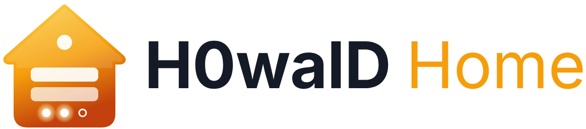
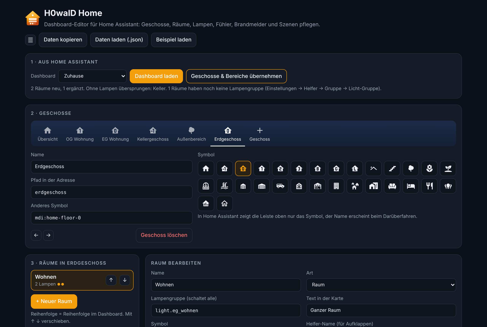
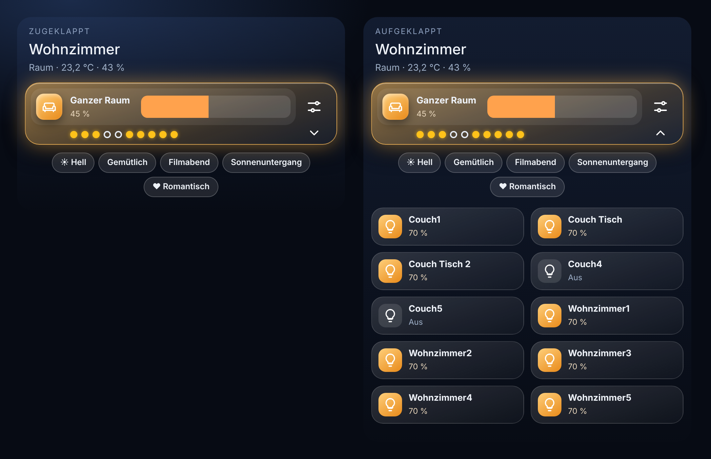
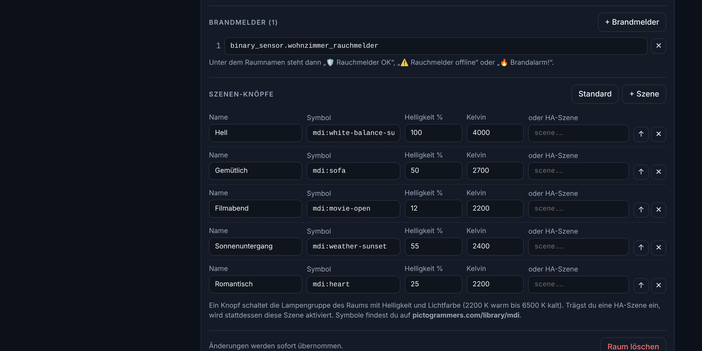

  <picture>
    <source media="(prefers-color-scheme: dark)" srcset="custom_components/h0wald_home/brand/dark_logo@2x.png">
    
  </picture>

# H0walD Home

**Dashboard-Editor für Home Assistant.** Liest Geschosse, Bereiche, Lampen, Fühler und Brandmelder direkt aus deinem Home Assistant und baut daraus ein Dashboard mit ausklappbaren Lampen, Szenen-Knöpfen und Brandmelder-Status. Gespeichert wird mit einem Klick.

> 🇬🇧 *A dashboard editor for Home Assistant, installed via HACS as a sidebar panel. It reads your floors, areas, lights, temperature/humidity sensors and smoke detectors from the registries, lets you arrange floors and rooms, edit scene buttons, and saves a sections dashboard with collapsible light lists straight into Home Assistant. It also creates the needed `input_boolean` helpers. UI is German.*

## Was es macht

- Jedes **Geschoss** wird eine eigene Ansicht mit Symbol in der Leiste oben (Keller, EG, OG, Garten …).
- Jeder **Raum** wird eine Kachel-Gruppe:
  - **Ganzer Raum** schaltet die Lampengruppe. Darunter zeigt pro Lampe ein Punkt, ob sie an oder aus ist.
  - Ein **Pfeil** klappt die einzelnen Lampen auf und zu.
  - **Temperatur, Feuchte und Brandmelder** stehen unter dem Raumnamen: „🛡️ Rauchmelder OK“, „⚠️ Rauchmelder offline“ oder „🔥 Brandalarm!“.
  - **Szenen-Knöpfe** schalten die Lampengruppe mit fester Helligkeit und Lichtfarbe oder aktivieren eine HA-Szene.

## Funktionen

- **Aus Home Assistant lesen:** Geschosse, Bereiche, Lampen (inkl. Licht-Gruppen, in den Vorschlagslisten mit Namen), Temperatur- und Feuchte-Fühler sowie Brandmelder werden automatisch zugeordnet.
- **Bestehendes Dashboard laden** und weiter bearbeiten. Fremde Ansichten und Abschnitte bleiben unverändert.
- **Geschosse** anlegen, benennen, sortieren, Symbol wählen.
- **Räume** anlegen, sortieren und einem Geschoss zuordnen.
- **Ziehen & Ablegen:** Geschosse, Räume, Lampen und Szenen am Griff ⠿ sortieren (auch per Touch und mit den Pfeiltasten). Einen Raum auf ein Geschoss ziehen verschiebt ihn, eine Lampe auf einen anderen Raum ziehen verschiebt sie, eine Szene auf einen Raum ziehen kopiert sie.
- **Live-Vorschau** des gewählten Raums mit echten Zuständen aus Home Assistant. Antippen eines Elements springt zum passenden Feld, Lampen und Szenen lassen sich direkt in der Vorschau sortieren.
- **Szenen-Editor:** Name, Symbol, Helligkeit, Farbtemperatur oder eine HA-Szene.
- **Im Dashboard speichern**, vorher wird automatisch eine Sicherung angelegt (herunterladbar).
- **Fehlende Helfer anlegen** per Klick, ohne `configuration.yaml`.
- **HA-Bereiche verwalten:** Lampen per Ziehen oder Auswahl in andere Bereiche verschieben, Lampen ohne Bereich zuordnen, Bereiche in ein anderes Geschoss legen, neue Bereiche und Geschosse anlegen. Der Editor zieht die Räume automatisch nach.
- **Editor als Tab im Dashboard:** Auf Wunsch kommt der Editor als eigener Tab (nur für dich sichtbar) direkt in dein Dashboard. Als Karte heißt er `custom:h0wald-home-card`.
- Hell- und Dunkelmodus wie in Home Assistant.

## Voraussetzungen

- Home Assistant **2024.8** oder neuer
- Über [HACS](https://hacs.xyz): [Mushroom](https://github.com/piitaya/lovelace-mushroom) und [card-mod](https://github.com/thomasloven/lovelace-card-mod)
- Ein Benutzer mit **Administrator**-Rechten

## Installation

### Über HACS (empfohlen)

1. HACS öffnen → ⋮ → **Benutzerdefinierte Repositories**.
2. URL dieses Repositories eintragen, Typ **Integration**, hinzufügen.
3. **H0walD Home** suchen, herunterladen und Home Assistant neu starten.
4. **Einstellungen → Geräte & Dienste → Integration hinzufügen → H0walD Home**.
5. In der Seitenleiste erscheint **H0walD Home**.

Ab Home Assistant **2026.3** zeigt HA unter Geräte & Dienste auch das eigene H0walD-Home-Symbol (aus `custom_components/h0wald_home/brand/`).

### Manuell

Den Ordner `custom_components/h0wald_home` nach `/config/custom_components/` kopieren, neu starten und wie oben ab Schritt 4 einrichten.

### Ohne Installation (Webseite)

`index.html` lässt sich auch direkt im Browser öffnen oder über GitHub Pages bereitstellen. Dann gibt es kein direktes Lesen und Speichern: Du fügst die Raw-Konfiguration deines Dashboards ein und kopierst den fertigen Code zurück.

## Benutzung

1. **Dashboard wählen** und **Dashboard laden**, wenn du ein bestehendes weiter bearbeiten willst.
2. **Bereiche aufräumen (optional):** Unter „HA-Bereiche, Lampen & Geschosse verwalten“ Lampen und Bereiche richtig zuordnen. Das wird sofort in Home Assistant gespeichert.
3. **Geschosse & Bereiche übernehmen:** legt aus deinen HA-Bereichen Geschosse und Räume an. Bereits vorhandene Räume (gleicher Name) werden nur ergänzt, nichts wird überschrieben. Bereiche ohne Lampen werden übersprungen.
4. **Geschosse bearbeiten:** In der Leiste wählen oder mit **+ Geschoss** anlegen. Name, Pfad und Symbol festlegen, mit ← → sortieren.
5. **Räume bearbeiten:** Lampengruppe, Lampen, Fühler, Brandmelder und Szenen prüfen. Sortieren geht am Griff ⠿ per Ziehen. Einen Raum verschiebst du, indem du ihn auf ein Geschoss oben ziehst (oder über **Geschoss**).
6. **Fehlende Helfer anlegen:** erstellt pro Raum einen Schalter `input_boolean.lampen_…`, der sich merkt, ob die Lampen aufgeklappt sind.
7. **Editor als Tab:** Haken bei „Editor als Tab im Dashboard“ setzen, dann ist der Editor nach dem Speichern auch im Dashboard selbst erreichbar (nur für den aktuellen Benutzer sichtbar).
8. **Im Dashboard speichern:** zweimal klicken zum Bestätigen. Die alte Fassung kannst du danach unter **Sicherung herunterladen** holen.

**Tipps**

- Am schönsten wird es mit einer **Licht-Gruppe pro Raum** (Einstellungen → Geräte & Dienste → Helfer → Gruppe → Licht-Gruppe). Sie wird automatisch als „Ganzer Raum“ erkannt.
- Brandmelder werden über die Geräteklasse `smoke` oder Namen mit `smoke`, `rauch` oder `alarm_detected` erkannt.
- Symbole findest du auf [pictogrammers.com/library/mdi](https://pictogrammers.com/library/mdi/).

## Datenschutz

Alles läuft in deinem Browser und in deinem Home Assistant. Es werden keine Daten an fremde Server geschickt. Der Editor ist nur für Administratoren sichtbar.

## Lizenz

[MIT](LICENSE) © 2026 H0walD. Enthält [js-yaml](https://github.com/nodeca/js-yaml) (MIT).
